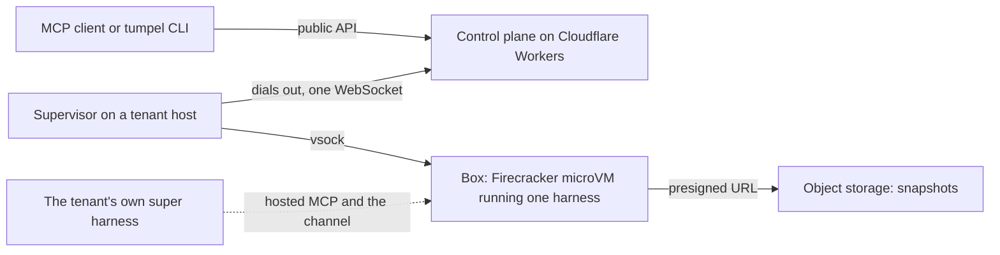

# RFC: Tumpel, harnesses on any hardware

| Field   | Value                                                                                                                                                                                                                                                                               |
| ------- | ----------------------------------------------------------------------------------------------------------------------------------------------------------------------------------------------------------------------------------------------------------------------------------- |
| Status  | Proposed                                                                                                                                                                                                                                                                            |
| Author  | Matthijs van Henten                                                                                                                                                                                                                                                                 |
| Date    | 2026-11-14                                                                                                                                                                                                                                                                          |
| Related | [ADR-001](../adr/001-control-plane-on-cloudflare.md), [ADR-002](../adr/002-multi-harness-provider-keys.md), [ADR-003](../adr/003-host-channel-dials-out-provider-agnostic.md), [ADR-004](../adr/004-typespec-to-rust-via-secondary-tooling.md), [ADR-005](../adr/005-hosted-mcp.md) |

## Summary

Tumpel runs coding agent harnesses on machines a tenant owns, including desktops at home, and drives them over MCP. A small Rust program on each machine, the supervisor, dials out to a control plane on Cloudflare. It runs every session in its own Firecracker microVM. A session is one conversation with one harness. A turn is one prompt and the harness's answer to it. The control plane hands each turn the provider credential it needs and keeps the transcript. After a turn, the supervisor copies the session's changed files to cold storage, so a session outlives its microVM and its host. People and agents call Tumpel through a hosted MCP server or the `tumpel` CLI, and both are clients of one public API.

## Tenets

- **Harnesses on any hardware.** Harnesses run on any hardware, including desktops at home, driven over MCP.
- **Rust out of sight.** Rust for everything that runs out of sight (the host supervisor, workers and agents on the host) and for the CLI.
- **TypeSpec first.** Radical shift left on the API: everything is modelled in TypeSpec first. Generate SDKs, types and anything else we can.
- **Every input has a schema.** Config, options and CLI arguments each have a versioned schema. A tenant keeps its config file in a git repo.
- **All primitives get wrapped.** The channel from the supervisor to the backend works the same on any compute: a Cloudflare Worker or a Lambda with WebSockets. Define the general protocol first, then plug in one backend.
- **Workers in TypeScript.** Cloudflare Workers in TypeScript: fastest, simplest, lowest maintenance. Only what sign-in and routing need before the tenant is known is stored centrally; everything else per tenant, in its own SQLite database.
- **No standing secrets.** No shared secrets anywhere, and no standing credential on a host.
- **Events drive the lifecycle.** Nothing sweeps and nothing polls.
- **Every phase has a time limit and a named failure.** Fail fast, with no retries and no fallbacks.
- **Agents prove it.** No human browser step is a precondition for the proof that the system works.
- **Design for end-to-end validation in every stage.** `npm run proof:e2e` runs the EDD-006 proof against each stage after its deploy.

## Problem statement

Coding agent harnesses such as Claude Code or Codex run in a terminal on the machine that starts them. Steering one from a phone, or running two or more side by side on hardware a tenant already owns, takes one open terminal session per harness. Each harness also reads its provider credential from the machine it runs on.

## Proposal

### Cloud agents

Tumpel is cloud agents: the infrastructure that runs harnesses. That means hosts, boxes, sessions, turns, personas, secret sets and credentials. A super harness is the management, communication and memory layer across harnesses. Tumpel builds no super harness. A tenant brings its own.

Tumpel has three parts. The supervisor runs on hosts the tenant brings: Linux machines with KVM. Cloudflare Workers run the control plane, which holds tenants, sessions and turns.



### Hosts and boxes

A host enrols with a one-time token and keeps one outbound WebSocket to the control plane. A box is one Firecracker microVM on a host, running one harness for one session. When a turn ends, the supervisor pauses the box and keeps it warm for the next one. Once that window ends, the box goes, and the next turn boots a fresh box from the session's snapshots.

### Sessions and turns

Each session belongs to a tenant and runs one harness on one host. The harness's output comes back as numbered lines that a caller reads with a cursor.

### Credentials

A persona names one harness and carries that harness's own config files. It names one secret set. Besides the GitHub App token for the session's repository, that set is the only source of secrets for its sessions. The control plane stores each value with envelope encryption, decrypts it per turn and sends it over the channel to the box.

### Snapshots

When a turn completes, the supervisor stores the box's files in object storage as chunks that every session of the tenant shares. A fresh box restores the session from its latest snapshot.

### Proof

Agents sign in, enrol the host, run real turns on a real harness and restore a session from its snapshots, with no person in a browser. The proof passed all twelve steps against `dev` on `tumpel-host`.

## Requirements

### Business requirements

- **BR-1 My hardware.** As a tenant, I want harnesses to run on machines I own, including a desktop at home, so that the work runs on hardware I already pay for.
- **BR-2 Steer from anywhere.** As a tenant member, I want to start and steer sessions from an MCP client or a terminal, so that work goes on while I am away from the machine.
- **BR-3 My provider accounts.** As a tenant owner, I want every turn to run on my own API key or subscription for that harness, so that I use the accounts I already have.
- **BR-4 Parallel work.** As an agent that dispatches work, I want sessions running side by side across the tenant's hosts, so that agents work in parallel.

### Functional requirements for accounts and hosts

- **FR-1 Sign up.** A person signs up with their email through Cloudflare Access. The first sign-in creates a tenant with that person as owner. (BR-1)
- **FR-2 Sign a client in.** The CLI signs in through a device code approved in a browser, and an MCP client signs in through OAuth. A tenant member lists its devices and revokes any of them. (BR-2)
- **FR-3 Enrol a host.** A tenant member mints a one-time enrolment token. The host that presents it makes a key pair, spends the token and reads Online. A host without KVM refuses to enrol and names what is missing. Revoking a host closes its connection at once. (BR-1)
- **FR-4 Harness catalog.** The catalog lists Claude Code, Codex, OpenCode and Pi.dev at pinned versions, and Mistral's coding agent joins it later. A tenant pins the version each harness runs. (BR-3)

### Functional requirements for sessions and turns

- **FR-5 Start.** A start names a persona, a model, a repository and a prompt. The harness and its pinned version come from the persona through the catalog. The answer names the session, its first turn and its host before any output. With no host free, the refusal lists every host and its state. (BR-2)
- **FR-6 Send.** A send to an idle session answers with the new turn id. While a turn runs, a send is refused, and the refusal quotes the running turn's id. (BR-2)
- **FR-7 Concurrency.** A tenant runs any number of sessions across its hosts, with more than one box per host. Each session runs one turn at a time. (BR-4)
- **FR-8 Read.** A read returns harness-native lines after a cursor, for the session or for one turn. The cursor stays valid across snapshots, fresh boxes and host moves. (BR-2)
- **FR-9 Stop and archive.** A stop snapshots the session at once, then tears its box down and leaves the session Stopped. A failed or unanswered stop returns the session to Idle and records a stop failure, which `tumpel session stop-failures` lists. An archive takes a Stopped session only. It deletes the snapshots, keeps the transcript readable and refuses later sends with `SessionArchived`. (BR-4)
- **FR-10 Warm window.** After each turn the box stays paused for a warm window, 15 minutes by default and set per host. A turn inside the window resumes the paused box. (BR-2)

### Functional requirements for credentials and configuration

- **FR-11 Credentials.** A secret set holds variables and one credential per provider, an API key or a subscription token with its expiry. A replaced value reaches the next turn and never a running one. A credential of a kind the harness does not take is refused `CredentialKindUnsupported`. An expired subscription token is refused `CredentialExpired` at start and send, and it fails a turn `CredentialExpired` at the offer. (BR-3)
- **FR-12 Snapshots.** After a completed turn and a quiet delay, the session's changed files land in object storage. A burst of turns yields one snapshot. A failed snapshot shows on the session with its reason. (BR-1)
- **FR-13 Config as code.** `tumpel config validate`, `plan` and `apply` keep a tenant's personas, secret sets, pins and host labels in one schema-checked file. A persona in the file names its harness and lists its files by local path. The file names environment variables for secret values and holds no value. A persona keeps the harness it was created with, and `apply` stops when a live persona runs another harness than the file names. A delete of a persona that a session ran on, or of a secret set a persona names, is refused with 409. (BR-2)
- **FR-14 Bring your own super harness.** A tenant plugs its own super harness in through the hosted MCP server and the channel into each box. Every other requirement holds with none plugged in. (BR-4)

### Non-functional requirements

- **NFR-1 No inbound ports.** A host accepts no connection from outside itself.
- **NFR-2 No standing credential.** A host's disk holds its own channel key and no provider, storage or git credential.
- **NFR-3 Secrets stay secret.** Secret values are stored with envelope encryption. No response, log line or transcript carries one.
- **NFR-4 Tenant isolation.** One tenant's token never reads another tenant's data, and a host serves one tenant.
- **NFR-5 The VM is the boundary.** The harness runs with full permissions inside its box. The box reaches the internet and never the host's internal network, the host or another box.
- **NFR-6 Events.** No job runs on a timer across a set of resources. A timer belongs to one resource and ends with it.
- **NFR-7 No silent turn.** Every phase has a budget and a named failure. Each failure carries the tail of the harness's standard error.
- **NFR-8 One versioned schema.** Every API operation, MCP tool, CLI argument and config file comes from the TypeSpec source and carries a version.
- **NFR-9 Wrapped primitives.** The channel, object storage, databases, the key store and timers are interfaces first. Cloudflare is the first backend for each. The key store wraps each tenant data key with a Workers secret, and that key has no rotation path yet.
- **NFR-10 Plain failures.** Every error states what failed and what fixes it. An expired sign-in reads as signed out, never as empty data.

### Operational requirements

- **OR-1 Install once.** One command installs a host with admin rights. The supervisor never escalates afterwards, and one command updates it. (BR-1)
- **OR-2 Static binaries.** The installer, the supervisor and the CLI ship as static binaries for Linux on x86_64 only for now. (BR-1)
- **OR-3 Audit.** Every credential handover records the turn, host, box and secret names. (BR-3)
- **OR-4 Agents prove each stage.** Agents run the proof on a real host against every stage after its deploy. (BR-2)

## Decisions

Cloudflare hosts the control plane (ADR-001). Tumpel is multi-harness, with personas, secret sets and per-session dispatch credentials (ADR-002). The host channel dials out and is defined before any backend (ADR-003). TypeSpec reaches Rust through secondary tooling (ADR-004). The MCP server is hosted (ADR-005). On 2026-11-14 the remaining rulings followed:

> To store creds per persona, use envelope encryption.

> The most important part is the workers are isolated from the internal network.

> Warm pooling is a logical thing to do, at least keep it warm for a little while.

On 2026-11-15 Tumpel became open source under Apache-2.0 ([RFC: Prebuilds](RFC-TUM-Prebuilds.md#decisions)).

### Domain and stages

**The domain for everything is `tumpel.dev`.** It serves the API, the hosted MCP server, the dashboard, and the installer and image downloads. Each stage has its own hostnames. `api.<stage>.tumpel.dev` serves the control plane. The dashboard serves on `<stage>.tumpel.dev`, and `app.<stage>.tumpel.dev` redirects to it. The OIDC issuer gets `id.<stage>.tumpel.dev`. Stage `prod` drops the stage label: `api.tumpel.dev`, `id.tumpel.dev`, and the dashboard on the apex `tumpel.dev`. OpenTofu manages every record. On 2026-11-15 the ruling read:

> tumpel.dev for everything

### Credentials and storage

**The provider credential is an environment variable.** For each turn, the box exports the provider credential into the harness's environment. A host-side gateway issuing per-session virtual keys is a non-goal for v1.

> I would follow industry.

**Each secret set member has a kind.** The kind is variable, API key or subscription token, and a subscription token carries its expiry. The harness catalog lists the credential kinds each harness takes and the variable it reads for each, such as `ANTHROPIC_API_KEY` or `CLAUDE_CODE_OAUTH_TOKEN` for Claude Code. One secret set serves personas for any harness.

**The central store holds accounts, hosts and the GitHub App.** It holds tenants, principals, memberships, invitations, devices, hosts and enrolment tokens. Sign-in and channel routing read them before they know the tenant. A membership is a principal's role in one tenant, and sign-in binds each token to one of them (EDD-005). It also holds the stage's GitHub App and each tenant's installation. GitHub's uninstall webhook names only the installation.

### Snapshot storage

**Snapshot bytes move on presigned URLs.** The control plane signs an upload URL for each pack and for each snapshot's root, and download URLs for a restore, so a host holds no storage key. Memory state never leaves the host.

**Snapshots are chunked and packed.** Only the chunks the tenant lacks leave the host. The host cuts each changed file into content-defined chunks and concatenates the new ones into packs of about 8 MiB. An archive deletes the packs that hold no remaining chunk and never repacks (EDD-004). The cost is a host chunk cache with no eviction, and packs that a failed snapshot leaves in storage.

> the duplicity model

### Runtime and surface

**Budgets.** A host claims a turn within 60 s, writes its first line within 120 s of the box holding the repository, and finishes within 3,600 s. The clone gets its own 120 s, the image's `cloneSeconds`, which the host sends on the claim. A snapshot follows 30 s of quiet. A host gets 300 s to hand a credential to its box.

**Channel ordering and reconnect.** Every message carries a sequence number and an acknowledgement. After a reconnect, each side resends what the other has not acknowledged, and the receiver drops duplicates.

**Repository access is a GitHub App installation token.** Every self-hosted control plane registers its own GitHub App, one per stage, at its own `/github/app/setup` page (ruling of 2026-11-15). Each tenant installs it. Each turn gets a token scoped to the session's repository as `GITHUB_TOKEN` and `GH_TOKEN` (EDD-003).

**MCP and CLI parity is a build check.** Every tenant operation is one MCP tool and one CLI command on the same handler, and the build fails on a gap. On 2026-11-15 the ruling put every tenant operation on MCP: only the OAuth, browser-only, host channel and release endpoints stay off it, and secret values still never pass through MCP.

> the mcp should allow it all

**A transcript read is the live poll.** A caller reads the transcript page by page until a page reads `finished`. A compact read of a Claude Code turn keeps the assistant's text and one line per tool call.

**The Shell harness exists for tests only.** The catalog leaves it out.

**The proof signs in with an Access service token.** The test run approves its own device code with a Cloudflare Access service token tied to a test tenant.

### Placement

**Placement after a host loss.** When a session's host is offline, its next turn boots on another of the tenant's online hosts, provided the snapshots cover the last completed turn. Otherwise the refusal names the host and the missing turns.

**Placement on capacity.** Each host reports its `boxCapacity` and its usage over the channel, and the tenant places each new session by them (EDD-001).

> we're going to hook up different sized boxes, right? a Raspberry Pi, an older Pentium, whatever

A host's free slots are its `boxCapacity`, minus the tenant's `Offered` and `Running` turns on it, minus its warm boxes. A host is Full when those turns fill its `boxCapacity`. A start goes to an Online host that is not Full and has an image for its architecture. The tenant ranks those hosts by free slots, then by available memory. When every host is Full, the tenant refuses the start `PoolExhausted` and lists each host's reason. A placed session keeps its host.

**Box capacity is set at install.** The installer makes a fixed pool of network devices, one per box. Its size, the host's `boxCapacity`, is 8 by default.

## FAQ

**Does Tumpel need a super harness?** No. Sessions, turns, transcripts and snapshots all belong to Tumpel. The tenant picks its own super harness, or none.

**Can I use a subscription instead of an API key?** Yes, for a harness whose catalog entry takes a subscription token, such as Claude Code.

**What happens when my host reboots mid-turn?** The turn fails with a named reason. On the next turn the session restores from its latest snapshot.

**Why a microVM per session instead of a container?** Inside its box the harness has full permissions. A VM keeps that power inside the box. A shared kernel does not.

**Does my host need a public IP?** No. The supervisor dials out.

**Is there a web dashboard?** Yes, on `<stage>.tumpel.dev` (`doc/product/dashboard.md`).

**Can the control plane move off Cloudflare?** Yes. A second backend implements the same interfaces.

## Appendix of terms

| Term          | Meaning                                                                                  |
| ------------- | ---------------------------------------------------------------------------------------- |
| Cloud agents  | Infrastructure that runs harnesses: hosts, boxes, sessions, turns, personas, credentials |
| Super harness | A tenant's own management, communication and memory layer across harnesses               |
| Host          | A tenant's Linux machine with KVM, running the supervisor                                |
| Supervisor    | The Rust program on a host that runs boxes                                               |
| Box           | One Firecracker microVM running one session's harness                                    |
| Session       | One conversation with one harness, outliving its boxes                                   |
| Turn          | One prompt and the harness's answer to it                                                |
| Persona       | A named harness with its config files, naming one secret set                             |
| Secret set    | Named encrypted values that a persona's sessions read                                    |
| Warm window   | How long a paused box waits for its next turn                                            |
| Snapshot      | A session's overlay files as a manifest plus chunks in packs                             |

## Appendix of entities

```tsp
model Session {
  @key sessionId: EntityId;
  tenantId: EntityId;
  principalId: EntityId;
  hostId: EntityId;
  boxId: EntityId;
  personaId: EntityId;
  repository: RepositoryUrl;
  harness: Harness;
  harnessVersion: HarnessVersion;
  `model`: ModelName;
  state: SessionState;
  lastTurnId: EntityId;
  lastTurnState: TurnState;
  lastTurnAt: offsetDateTime;
  createdAt: int64;
  updatedAt: int64;
}

enum SessionState {
  Starting: "Starting",
  Idle: "Idle",
  Running: "Running",
  Stopping: "Stopping",
  Stopped: "Stopped",
  Archived: "Archived",
}

model Turn {
  @key turnId: EntityId;
  tenantId: EntityId;
  sessionId: EntityId;
  boxId: EntityId;
  prompt: Prompt;
  state: TurnState;
  lineCount: Sequence;
  createdAt: int64;
  updatedAt: int64;
}

model Persona {
  @key personaId: EntityId;
  tenantId: EntityId;
  name: DisplayName;
  harness: Harness;
  secretSetId: EntityId;
  files: PersonaFile[];
  createdAt: int64;
  updatedAt: int64;
}

model PersonaFile {
  path: PersonaFilePath;
  digest: Sha256Digest;
  sizeBytes: PersonaFileSize;
  createdAt: int64;
  updatedAt: int64;
}

model SecretSet {
  @key secretSetId: EntityId;
  tenantId: EntityId;
  name: DisplayName;
  keys: SecretKey[];
  createdAt: int64;
  updatedAt: int64;
}

enum SecretKind {
  Variable: "Variable",
  ApiKey: "ApiKey",
  SubscriptionToken: "SubscriptionToken",
}

model SecretVariableKey {
  kind: SecretKind.Variable;
  name: SecretName;
  updatedAt: int64;
}

model ApiKeyKey {
  kind: SecretKind.ApiKey;
  name: SecretName;
  provider: ModelProvider;
  updatedAt: int64;
}

model SubscriptionTokenKey {
  kind: SecretKind.SubscriptionToken;
  name: SecretName;
  provider: ModelProvider;
  expiresAt: offsetDateTime;
  updatedAt: int64;
}

union SecretKey {
  Variable: SecretVariableKey,
  ApiKey: ApiKeyKey,
  SubscriptionToken: SubscriptionTokenKey,
}

model HarnessCatalogEntry {
  @key harness: Harness;
  @key harnessVersion: HarnessVersion;
  provider: ModelProvider;
  credentialVariables: CredentialVariable[];
  personaFilePaths: PersonaFilePath[];
  installRecipe: string;
}

enum CredentialKind {
  ApiKey: "ApiKey",
  SubscriptionToken: "SubscriptionToken",
}

model CredentialVariable {
  kind: CredentialKind;
  variable: SecretName;
}

model Snapshot {
  @key snapshotId: EntityId;
  tenantId: EntityId;
  sessionId: EntityId;
  boxId: EntityId;
  turnId: EntityId;
  snapshotSeq: Sequence;
  storageKey: StorageKey;
  outcome: SnapshotOutcome;
  createdAt: int64;
  updatedAt: int64;
}
```

## Appendix of engineering design documents

| EDD                                                | Topic                                                                             |
| -------------------------------------------------- | --------------------------------------------------------------------------------- |
| [EDD-001](../EDD/001-runtime.md)                   | Runtime: boxes, the warm window, host setup, networking                           |
| [EDD-002](../EDD/002-host-channel.md)              | Host channel: protocol, budgets, named failures, reconnect                        |
| [EDD-003](../EDD/003-credentials.md)               | Credentials: personas, secret sets, encryption, handover, audit, repository token |
| [EDD-004](../EDD/004-snapshots-and-transcripts.md) | Snapshots and transcripts: storage, upload, restore                               |
| [EDD-005](../EDD/005-mcp-and-cli.md)               | MCP and CLI: hosted MCP, sign-in, parity, config as code                          |
| [EDD-006](../EDD/006-end-to-end-proof.md)          | Proof: what agents run, where, and what passes                                    |
