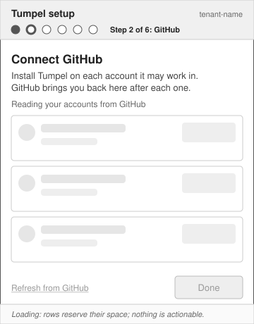
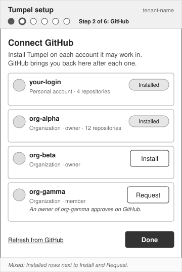
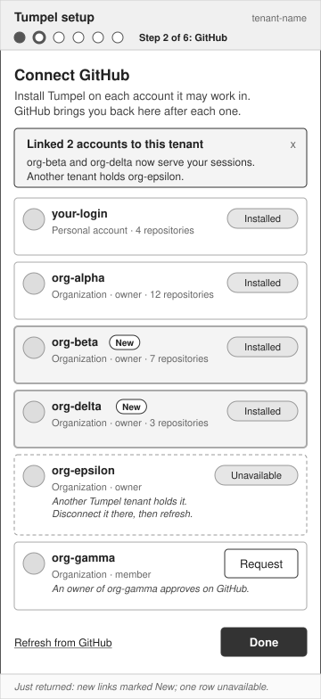
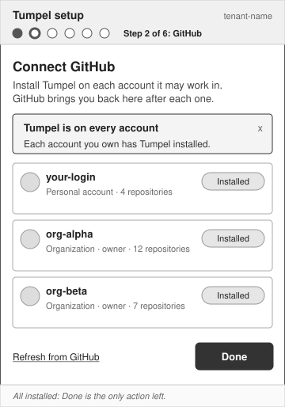
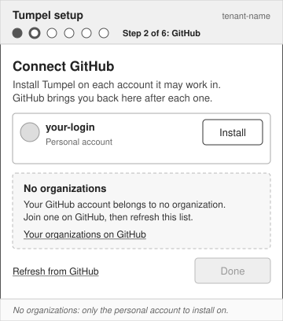
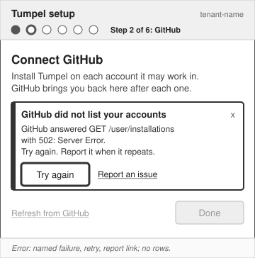
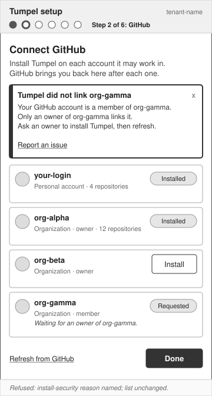
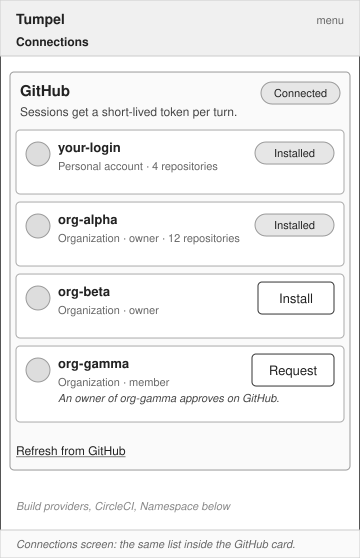

# GitHub accounts

## Summary

One list connects GitHub. It shows the operator's personal account and each organization they belong to. Each row reads Installed or holds an Install button. Install opens GitHub's install page for that one account. GitHub then returns the operator to the same list, updated, with Done to finish. The first-run wizard's GitHub step and the GitHub card on Connections show the same list ([dashboard.md](dashboard.md), Connections; story S2).

GitHub installs an App on one account per visit. The list turns those visits into one flow: each visit ends on the list, and the list shows what is left.

## Rows

| Row state   | Shown when                                                             | Action  |
| ----------- | ---------------------------------------------------------------------- | ------- |
| Installed   | The tenant holds the installation on this account                      | None    |
| Install     | No installation, and the operator is the account or an org owner       | Install |
| Request     | No installation, and the operator is an org member                     | Request |
| Requested   | GitHub returned `setup_action=request` for this org                    | None    |
| Unavailable | An installation exists that this tenant cannot link; the row names why | None    |

Each row shows the login, Personal account or Organization with the role, and the covered repository count once installed. An Installed row that GitHub suspended reads Suspended, as on Connections today. A Tumpel Member sees Install and Request as Ask an Owner, which opens Members.

Unavailable has two reasons:

1. Another Tumpel tenant holds it. Disconnect it there, then refresh.
2. Only an owner of the org links it. Ask an owner to install Tumpel, then refresh.

## Where the list comes from

GitHub hands the control plane a user code on every return (`request_oauth_on_install` is on). The control plane exchanges it for a user token and makes three calls with it:

1. `GET /user` names the personal account.
2. `GET /user/installations` lists this App's installations the operator can reach.
3. `GET /user/memberships/orgs?state=active` lists every org the operator belongs to, with the role `admin` or `member`.

GitHub lists all three among the endpoints a GitHub App user token can call, and none of them sits under an App permission. The manifest needs no change. `Members: read` stays for `GET /user/memberships/orgs/{org}`, the owner check on link. `GET /user/orgs` does not fit: GitHub answers it with an empty list for a fine-grained token. Implementation must prove that `GET /user/memberships/orgs` lists orgs without this App installed.

An org with no installation becomes an Install or Request row. The control plane stores the merged list per tenant (logins, roles, installation ids, row states) and drops the user token. The dashboard reads that stored list.

Install sends the browser to `GitHubConnections_start` for that account. Its `installUrl` carries the account's `target_id`, so GitHub opens on that account. Refresh from GitHub sends the browser to GitHub's OAuth consent page with the App's client id. GitHub returns at once when the operator approved the App before.

## Linking on return

On every return the control plane links each installation from `GET /user/installations` that no tenant holds yet. It runs the owner check of today's install callback on each one. An installation that another tenant holds reads Unavailable for reason 1. One that fails the owner check reads Unavailable for reason 2. The return then lands on the list with `?from=github`.

## API needs

1. A1 `GitHubConnections_listAccounts`: the stored list, one `GitHubAccount` per row with its login, kind, role, row state and Unavailable reason.
2. A2 `GitHubConnections_start` takes an account id and answers an `installUrl` for that account.
3. A3 `GitHubConnections_refresh` answers a GitHub OAuth URL whose return reruns the three calls and the linking.
4. A4 The installed callback accepts a code with no installation id, from A3.

## Layout

Phone first. Rows are full width and 64 px tall, with the action on the right. Refresh from GitHub and Done sit under the last row. On Connections the list fills the GitHub card, and Done shows only after a return.

## Keyboard and focus

Tab moves through each row's action in list order, then Refresh from GitHub, then Done. Install, Request and Refresh are links that leave the dashboard in the same tab. A banner's close control and Esc on a focused banner close it and strip `from` and `refused` from the query. The list is part of the page, so a click outside closes nothing.

## URL

| Screen      | Path                         | Query after a return                                                |
| ----------- | ---------------------------- | ------------------------------------------------------------------- |
| Wizard      | `/t/<tenantId>/setup/github` | `?from=github`, plus `&refused=<code>&account=<login>` on a refusal |
| Connections | `/t/<tenantId>/connections`  | The same                                                            |

The query carries a refusal code (`NotInstaller`, `MembershipUnreadable` or `OtherTenant`) and a login. The dashboard maps the code to the reason and the fix. A refusal before the tenant is known (an expired link, another sign-in) stays on the control plane's refusal page, which links back to the dashboard.

## States

Every state is one story of `Dashboard/Connections/GitHubAccounts`. `Dashboard/FirstRun/GitHubStep` adds the story `AccountList`, the mixed list inside the wizard frame.

| State              | Story             | Enters on                              |
| ------------------ | ----------------- | -------------------------------------- |
| Loading            | `Loading`         | The path opens, A1 in flight           |
| Mixed list         | `MixedList`       | A1 answers rows in more than one state |
| After a return     | `JustReturned`    | `?from=github` and new links           |
| All installed      | `AllInstalled`    | Every row Installed                    |
| No orgs            | `NoOrganizations` | A1 answers only the personal account   |
| Error              | `ListFailed`      | A1 or the return's GitHub call failed  |
| Refused            | `InstallRefused`  | `?from=github&refused=<code>`          |
| Connections screen | `OnConnections`   | `/t/<tenantId>/connections`            |

### Loading

Three placeholder rows hold the list's space. Refresh and Done are disabled. Focus stays on the heading. A1 past 10 s turns into the error state with the timeout named.

### Mixed list

Installed rows sit next to Install and Request rows. Focus lands on the heading, and Tab reaches the first Install. Done is enabled once one row reads Installed. In the wizard Done opens `/t/<tenantId>/setup/host`.

### After a return

A status banner counts the new links and names any Unavailable row. New links carry a New mark until the next visit. Focus lands on the banner, then Tab reaches Done. Done or the banner's close control strips `?from=github`.

### All installed

A banner says Tumpel is on every account the operator owns. Focus lands on Done. Refresh stays, for an org joined later.

### No orgs

The personal account is the only row. A note says the GitHub account belongs to no organization, and links to its organizations page on GitHub. Done stays disabled until the personal account reads Installed.

### Error

The alert gives the failed call, GitHub's status and the fix. Try again reruns A1, and A3 when the failure came from a return. Report an issue opens a prefilled issue with the failure text. Focus lands on Try again.

### Refused

An alert names the account and why Tumpel did not link it, with the fix: ask an owner, or disconnect it in the other tenant. The list stays as it was. Focus lands on the alert, and its close control strips `refused` and `account`. Report an issue sits in the alert.

### Connections screen

The GitHub card holds the same list and Refresh from GitHub. Done shows after a return. Disconnect stays on each Installed row's menu, as on Connections today.

## CircleCI

CircleCI's OAuth App gets one user token that reaches every org granted on GitHub's one consent screen. Tumpel's tenets rule that out: that token lives for months and reaches every repository the user can reach. A GitHub App with one install per account stays the right route, and the list above makes those installs one flow.
