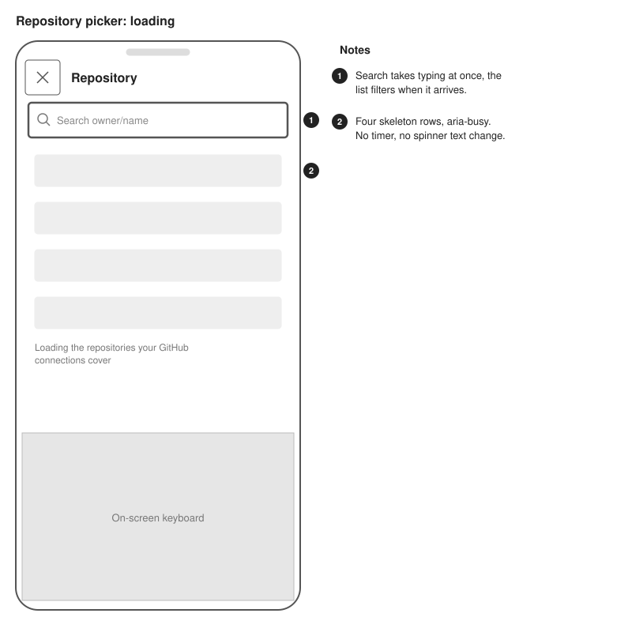
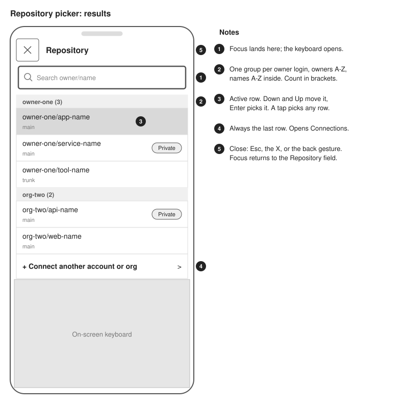
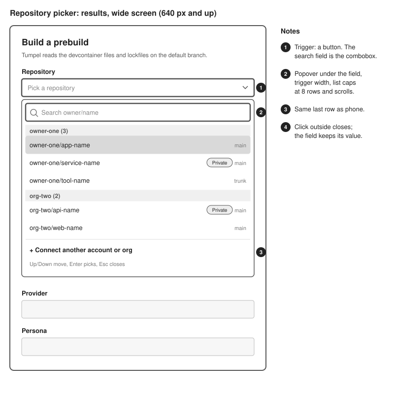
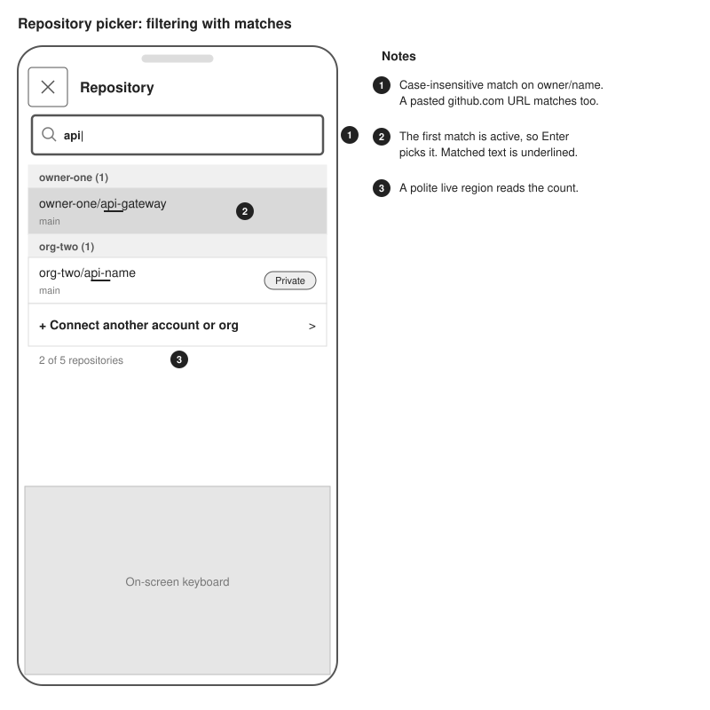
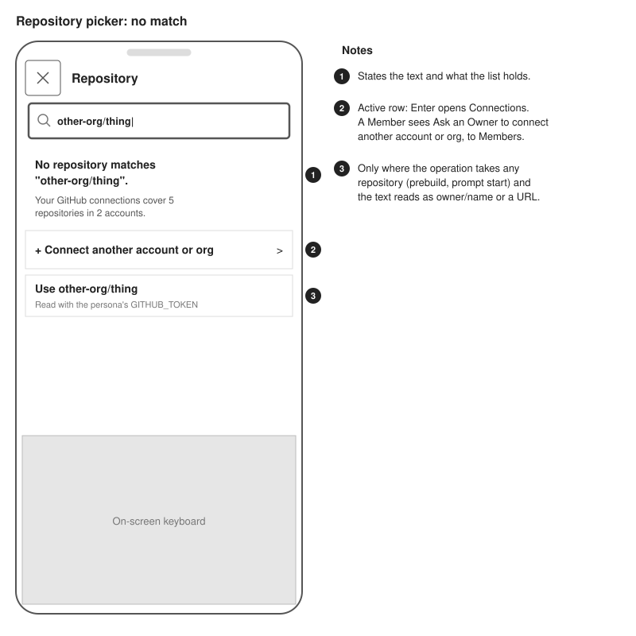
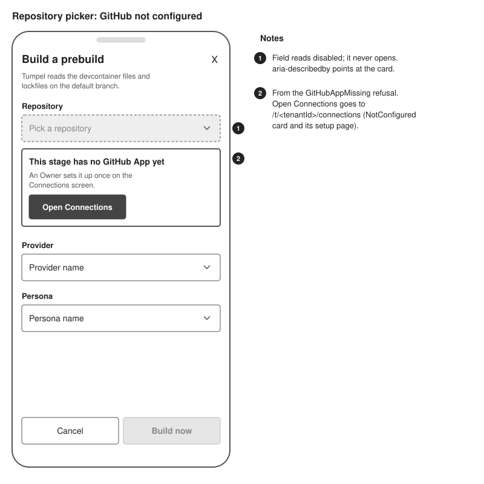
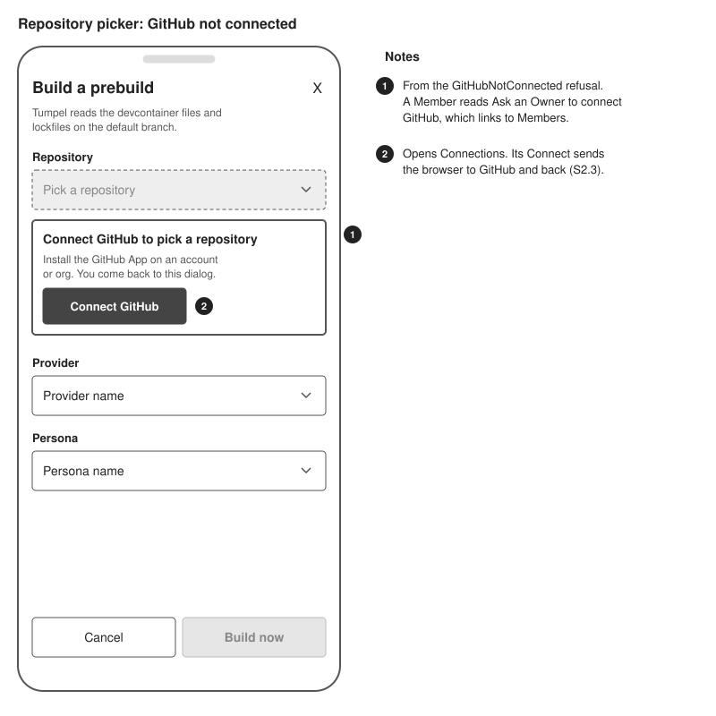
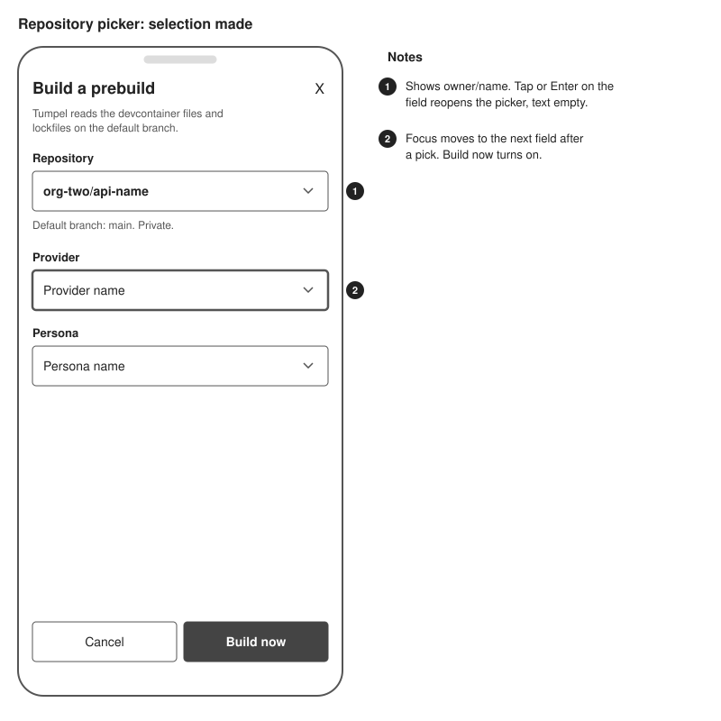
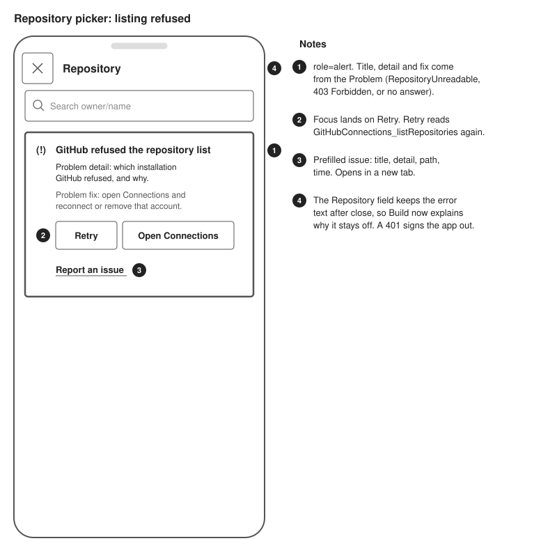

# Repository picker

## Summary

Every dashboard form that needs a repository asks for it with one searchable picker. The picker lists the repositories that every GitHub installation of the tenant covers, grouped by owner. Typing filters the list. A tap or Enter picks a repository. A missing repository needs one more GitHub account or org. The picker links to Connections for that ([dashboard.md](dashboard.md), Connections; story S2).

## Data

The picker reads `GitHubConnections_listRepositories` once per open screen, through the `useRepositories` query, and again on Retry. Each `GitHubRepository` gives the row its `owner`, `name`, `defaultBranch` and `private`. The form sends `htmlUrl` where the operation takes a `RepositoryUrl` (`Prebuilds_start`, `Sessions_start`) and `owner` with `name` where it takes a path (`Sessions_startFromIssue`).

| Refusal                | State                         |
| ---------------------- | ----------------------------- |
| `GitHubAppMissing`     | Not configured                |
| `GitHubNotConnected`   | Not connected                 |
| `RepositoryUnreadable` | Listing refused               |
| 403, unreachable       | Listing refused               |
| 401                    | The app-wide signed-out state |

A Member sees each Connect control as Ask an Owner, which opens Members.

## Layout

On a phone, under 640 px, a full-screen sheet covers the dialog. A close control and the title sit on top, then the search field, then the list. Rows are 52 px tall and the group headings 26 px. Wider screens get a popover under the field, as wide as the field, eight rows tall before it scrolls.

The search field takes `inputmode="search"`, `enterkeyhint="go"`, `autocapitalize="off"`, `autocorrect="off"` and `spellcheck="false"`. It matches case-insensitively on `owner/name`. A pasted `https://github.com/owner/name` or `.../name.git` matches as `owner/name`.

## Keyboard

Enter, Space or Alt+Down on the trigger button opens the picker with focus in the search field. The search field is the combobox: Down and Up move the active row, Home and End jump to the first and last row, and Enter picks the active row. Connect and Use rows are options in the same list. Esc closes the picker and returns focus to the trigger. A pick closes the picker and moves focus to the next field of the form. Tab from the search field closes the picker without a pick.

Esc, the close control and the back gesture close the open picker. On a wide screen a click outside closes it too.

## URL

The open picker and its search text hold nothing in the URL. On start-session, the pick sits in the query as `?repo=<owner>/<name>` on both tabs, so a reload or a shared link opens the same form. The prebuild dialog keeps the pick in its own state; its `#build` fragment stays, and `?repo=` on Prebuilds keeps selecting the side-panel row.

## States

### Loading

The picker opens before the list arrives. Four skeleton rows hold its place, with `aria-busy` and a screen-reader line. Typing works at once and filters when the list lands.

### Results

Each owner login heads a group with its count. Owners and names sort A to Z. A row shows `owner/name`, the default branch, and Private for a private repository. The last row opens Connections to add an account or org.

### Filtering

The list keeps only matching rows and their groups. The matched text is underlined and the first match is active. A polite live region reads "2 of 5 repositories".

### No match

The picker names the text and what the list holds. The Connect row is active and opens `/t/<tenantId>/connections`. When the text reads as `owner/name` and the operation takes any repository, a Use row sends that repository for the persona's `GITHUB_TOKEN` to read.

### Not configured

The stage has no GitHub App. A card under the disabled field says so, with Open Connections, where the NotConfigured card links the setup page. Build now stays off.

### Not connected

The tenant holds no installation. The card reads Connect GitHub to pick a repository, with Connect GitHub to Connections.

### Selected

The field shows `owner/name`. Its hint names the default branch and marks a private repository. The main button turns on once the other fields are set.

### Listing refused

The picker shows the Problem's title, detail and fix, with Retry, Open Connections and Report an issue. The report link opens a prefilled issue with the title, detail, path and time. After close, the field shows the title as its error. That tells the reader why the main button stays off.

## Interaction spec

The four overlay states (Loading, Results, Filtering, No match) and Listing refused close as the Keyboard section states. Focus then returns to the trigger.

| State           | Enters                                      | Leaves                                                       | Focus on entry                         | URL                                      | Story                    |
| --------------- | ------------------------------------------- | ------------------------------------------------------------ | -------------------------------------- | ---------------------------------------- | ------------------------ |
| Loading         | Opening while `useRepositories` is pending  | Any state below once the read settles                        | Search field                           | Nothing                                  | `Loading`                |
| Results         | A read with one repository or more          | Filtering on typing, Selected on a pick, Connections         | Search field, first row active         | Nothing                                  | `Results`, `ResultsWide` |
| Filtering       | Text that matches a row                     | No match, Selected; closing drops the text                   | Stays in the search field              | Nothing                                  | `Filtering`              |
| No match        | Text that matches no row, or an empty read  | Filtering on edit, Connections, Selected through the Use row | Search field, Connect row active       | Nothing; Connections returns here (S2.3) | `NoMatch`                |
| Not configured  | `GitHubAppMissing`                          | Connections, or Loading when tab focus reads the list again  | Unchanged; field described by the card | Nothing                                  | `NotConfigured`          |
| Not connected   | `GitHubNotConnected`                        | Connect GitHub; the install returns here and the list loads  | Unchanged; field described by the card | Nothing                                  | `NotConnected`           |
| Selected        | A pick                                      | Results when the field opens again, with an empty search     | The following field of the form        | `?repo=<owner>/<name>` on start-session  | `Selected`               |
| Listing refused | `RepositoryUnreadable`, a 403, or no answer | Loading on Retry, Connections                                | Retry                                  | Nothing                                  | `ListingRefused`         |

An empty read shows No match with the copy "Your GitHub connections cover no repository".

## Call sites

| File and lines                                                | Asks for                                                                               | Picker sends                |
| ------------------------------------------------------------- | -------------------------------------------------------------------------------------- | --------------------------- |
| `packages/dashboard/src/screens/rebuild-prebuild.tsx:143-157` | Build a prebuild: a pasted repository URL, with its URL-shape message at `:96`         | `htmlUrl`, Use row allowed  |
| `packages/dashboard/src/screens/start-session.tsx:466-479`    | Start a session, Write a prompt: a pasted Repository URL in `?url=`                    | `htmlUrl`, Use row allowed  |
| `packages/dashboard/src/screens/start-session.tsx:358-400`    | Start a session, From an issue: the generic `Picker` with no groups and no connect row | `owner`, `name`, no Use row |
| `packages/dashboard/src/screens/start-session.tsx:220`        | The not-connected card tells the reader to give the repository URL                     | The Not connected state     |
| `packages/dashboard/src/screens/prebuilds.tsx:368`            | The empty Prebuilds list says Build now takes any GitHub repository                    | Copy follows the picker     |

The CircleCI project binding has no dashboard form; `tumpel circleci project add` binds a repository, and the connect toast at `packages/dashboard/src/screens/connection-dialogs.tsx:208` names that command. A binding form takes the picker and sends `htmlUrl` as `CircleCIProjectAdd.repository`. No dashboard screen asks for a prebuild fixture.

## Stories

Every story sits under the title `Dashboard/Shared/RepositoryPicker` and renders in the Build a prebuild dialog at `/t/<tenantId>/prebuilds#build`, with `fakeApi` answering `listRepositories`. Phone stories use a 390 px viewport.

| Story            | State           | `listRepositories` answers                   |
| ---------------- | --------------- | -------------------------------------------- |
| `Loading`        | Loading         | a promise that never settles                 |
| `Results`        | Results, phone  | five repositories in two owners              |
| `ResultsWide`    | Results, wide   | the same five                                |
| `Filtering`      | Filtering       | the same five, play types `api`              |
| `NoMatch`        | No match        | the same five, play types `other-org/thing`  |
| `NotConfigured`  | Not configured  | `GitHubAppMissing`                           |
| `NotConnected`   | Not connected   | `GitHubNotConnected`                         |
| `Selected`       | Selected        | the same five, play picks `org-two/api-name` |
| `ListingRefused` | Listing refused | `RepositoryUnreadable`                       |

## API fit

`GitHubRepository` carries every field the picker shows. `GitHubConnections_listRepositories` answers every installation or one refusal. So one unreadable installation hides the repositories of all the others. The Listing refused state names the fix that the Problem carries.

## FAQ

**Why a full-screen sheet on a phone?** The on-screen keyboard takes half the screen. A sheet keeps the search field and five rows above it.

**Can someone still use a repository the App does not cover?** Yes, on Build a prebuild and Write a prompt: type `owner/name` or paste its URL, then pick the Use row. The persona's `GITHUB_TOKEN` reads it.

**Why does From an issue have no Use row?** `GitHubConnections_listIssues` reads issues with the installation on the owner, so an uncovered repository has no issue list.
