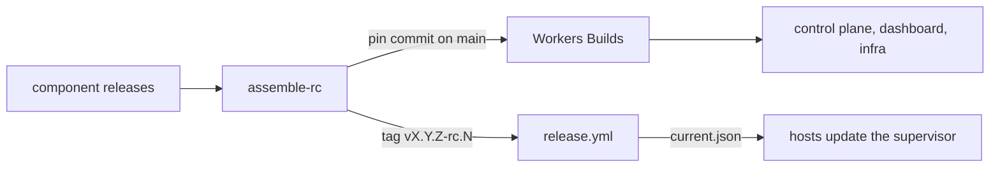

# Release

A release puts tested component versions on the stage `dev`. Each component repository publishes its own releases. tumpel/deploy pins one version of each in `release-pins.json`, tags a release candidate (RC) and publishes it. `doc/deploy.md` covers the Workers Builds projects, the stage layout and bootstrap.

## Candidate evidence

Component dispatches and manual runs use the same assembly path. Assembly advances the pins before starting publication. Publication and code deployment log a notice and use the default path when `release-candidate.json` is absent or carries no `clients` evidence.

A candidate with `clients` evidence enables the strict path. Its frozen digest, stage, pins, exact client commits, protocol and checksums must match. Missing readiness, stale evidence, failed checks and authentication errors abort that path. They never select the default path.

Strict publication verifies exact-SHA checks and fresh Tumpel-run CLI, supervisor and MCP readiness, including every online supervisor's version, before claiming the stage or changing `current.json`. It then publishes the manifest, reads back the stage's manifest and binary bytes, and writes the prepared receipt. A failed write releases the claim. A failed read-back or receipt write conditionally restores the old manifest and claim. A released claim, or a manifest that had no previous value, is stored as JSON null. Restoration uses [conditional R2 writes](https://developers.cloudflare.com/r2/api/s3/conditional-operations/). A failed restoration aborts and requires recovery of the same candidate before another release.

Readiness polls observe at most ten times with nine sleeps of 1 through 256 seconds.

Every code entry reads the same optional candidate, including retries and manual pins. Strict activation requires the prepared receipt, stage ownership, matching infra fingerprint and fresh readiness. It deploys and verifies dashboard bytes before migrations and API activation. It rechecks evidence between mutations and records successful Worker activation. A pin change with mismatched candidate evidence fails.

This repository consumes readiness records; it does not produce trusted client acknowledgements. The default path remains active while the current pipeline supplies no candidate client evidence. The strict path requires the matching readiness producer and candidate artifact together.

## Components

| Component     | Released as                                                                        | Pinned by                                                      |
| ------------- | ---------------------------------------------------------------------------------- | -------------------------------------------------------------- |
| protocol      | GitHub pre-release `vX.Y.Z-rc.N` with npm tarballs; `tumpel-api` on crates.io      | `package.json` dependency URLs, edited by hand                 |
| supervisor    | GitHub pre-release `vX.Y.Z-rc.N` with binaries, `.sha256` files and `release.json` | `supervisor` in `release-pins.json`                            |
| cli           | GitHub pre-release `vX.Y.Z-rc.N` with the binary and its `.sha256`                 | `cli` in `release-pins.json`                                   |
| control-plane | a `main` commit whose `checks` run passed                                          | `controlPlane` in `release-pins.json`                          |
| infra         | a `main` commit whose `checks` run passed                                          | `infra` in `release-pins.json`                                 |
| dashboard     | GitHub release `vX.Y.Z` with tarballs                                              | `packages/dashboard-site/package.json` in tumpel/control-plane |
| guest images  | a tag `images-vX.Y.Z` on tumpel/deploy                                             | `images.json` in the release bucket                            |

Protocol, supervisor and cli run `release.yml` on every push to `main` that changes a shipped file. It publishes the GitHub pre-release `vX.Y.Z-rc.N`. The conventional commits since the latest stable tag pick `X.Y.Z`, and `N` counts the commits since that tag. A published release is never overwritten. A person runs `promote.yml` with one RC tag to publish the stable `vX.Y.Z`. Promote checks out the RC's commit, builds it again, tags it and publishes the release as Latest. It also publishes crates: `tumpel-api` from protocol, `tumpel-channel`, `tumpel-guest` and `tumpel-supervisor` from supervisor, and `tumpel` from cli.

Control-plane and infra have no release workflow. Their `checks.yml` runs on every push to `main`, and assemble-rc pins the newest commit that passed. A pull request on tumpel/deploy can also set either pin by hand.

The dashboard releases when a person pushes a tag `vX.Y.Z` that matches the version in every `packages/*/package.json`. tumpel/control-plane installs one dashboard release by URL. A new dashboard ships when a control-plane commit moves that URL and tumpel/deploy pins that commit.

## The tumpel-api crate

The RC run of protocol publishes `tumpel-api` at the RC version to crates.io with the organization secret `CARGO_REGISTRY_TOKEN`. It skips a version crates.io already holds. Promote publishes the stable version through crates.io trusted publishing. The supervisor pins an RC exactly, as `tumpel-api = "=0.21.0-rc.24"`. The cli pins the git tag `v0.21.0-rc.20` of tumpel/protocol.

## Assembling a release candidate

`.github/workflows/assemble-rc.yml` runs `npm run release:rc`. It starts on a repository dispatch `component-released`, or by hand (Actions, assemble-rc, Run workflow). The input `dry-run` prints the pin diff and the tag and writes nothing. One run goes at a time.

The default path picks the newest version of every key in `release-pins.json`:

- `supervisor` and `cli`: the newest release tagged `vX.Y.Z` or `vX.Y.Z-rc.N`, in semver order. It skips drafts and every other tag, such as `-main.N`.
- `controlPlane` and `infra`: the head commit of the newest successful `checks` run on a push to `main`, among the last 50 successful push runs.

The run fails when:

1. `release-pins.json` names a key with no release source.
2. A repository has no matching release, or no `main` commit whose checks passed.
3. The newest release is older than the pin.
4. A commit pin is no 40-character sha, or the newest passing commit is behind or diverged from it.
5. tumpel/deploy holds no tag `vX.Y.Z` or `vX.Y.Z-rc.N` to continue from.

The tag follows the highest release tag. `v0.2.50-rc.9` leads to `v0.2.50-rc.10`, and a stable `v0.2.50` leads to `v0.2.51-rc.1`. When no pin changed and `HEAD` already carries a release tag, the run tags nothing. Otherwise it commits the new pins to `main` as `chore(release): pin the latest releases for <tag>`, pushes the tag and starts `release.yml` on it.

## Publishing a release

`.github/workflows/release.yml` runs on a tag `v*` and by hand. It builds no supervisor or cli binary. It publishes to the R2 bucket `tumpel-releases-dev`, and a manual run can name another stage. It builds amd64 only, because the workflow flag `BUILD_ARM64` stays `false`. Every job of `release.yml`, `images.yml` and `assemble-rc.yml` runs on `ubuntu-latest`.

1. `layers` checks the bucket for each harness layer. It builds the missing ones with `npm run harness:layer` and uploads them.
2. `publish` downloads the pinned supervisor and cli from their GitHub releases, checks each against its `.sha256` and writes `current.json`.
3. `promote` runs on a tag only after successful publication. It pushes the tag's commit to the branch `release`, and a push that is no fast-forward fails.

`publish` refuses when:

1. A pin names an RC and the stage is not `dev`.
2. The supervisor's `release.json` names a channel or guest protocol window that misses this commit's, or a guest window that leaves out the guests of `images.json`.
3. The supervisor asset's sha256 differs from the one `release.json` names.
4. The bucket holds no `images.json`, or its guest protocol lies outside `GuestProtocol.Oldest` to `GuestProtocol.Version`.
5. A harness has no layer for an enabled architecture.
6. The commit is an ancestor of the commit `current.json` holds. A tag run fails with "tag a newer commit". A manual run leaves `current.json` unchanged.

A tag run writes the tag as `releaseVersion`. A manual run writes `0.0.0-` and the first 12 characters of the commit. Runs on one stage queue, and a newer run never cancels a running one. The token `tumpel-releases-upload-<stage>` writes the bucket. `TUMPEL_REPOSITORY=tumpel/deploy npm run release:secrets` sets the workflow secrets `CLOUDFLARE_ACCOUNT_ID`, `R2_RELEASES_ACCESS_KEY_ID` and `R2_RELEASES_SECRET_ACCESS_KEY` from the tofu outputs.

## Workers Builds and the release branch

The Workers Builds projects `tumpel` and `tumpel-infra` build the branch `main` of tumpel/deploy. `tumpel` builds on every push to `main`. `tumpel-infra` builds on a push that changes `release-pins.json`, `npm-scripts/deploy-infra.mjs` or `packages/infra-worker/`. The control plane, dashboard and infra deploy when a pin commit lands on `main`. In the default path those builds and `release.yml` run side by side. An evidenced candidate reaches main only after successful publication. No build reads the branch `release`.

## Merge to dev

These times were measured over the 14 days to 2026-11-21.

| Component     | Merge to release           | Wait for assemble-rc              | Then                                                       |
| ------------- | -------------------------- | --------------------------------- | ---------------------------------------------------------- |
| supervisor    | RC ready about 6 min       | 0 to 399 min, manual              | `release.yml` writes `current.json` in about 1 min         |
| cli           | RC ready about 4.3 min     | 0 to 399 min, manual              | `release.yml` writes `current.json` in about 1 min         |
| control-plane | checks pass in about 1 min | a pin PR, then manual assemble-rc | Workers Builds deploys; Actions does not show its duration |

## The release manifest

`current.json` in `tumpel-releases-<stage>` is the current release, a `ReleaseManifest` (`typespec/lib/release.tsp` in tumpel/protocol). `release.yml` is its only writer. It names the release version, the commit, the channel protocol, and the supervisors, clis, images, bases and harness layers. Apart from `current.json` and `images.json`, every object in the bucket sits under its digest and never changes.

The control plane serves it at `GET /v1/releases/current` without sign-in and caches it for 30 s. `GET /v1/releases/supervisor/{architecture}` and `GET /v1/releases/cli/{architecture}` answer 302 to the pinned GitHub release asset. `GET /v1/releases/install.sh` installs the cli that `current.json` names.

## Host self-update

A write of `current.json` raises an R2 event on the queue `tumpel-releases-<stage>`. The control plane consumes it and sends ReleasePublished to every Online host.

A supervisor reads `/v1/releases/current` at each Welcome, on each ReleasePublished, and when the control plane refuses its channel protocol. It updates when the sha256 for its architecture differs from its own binary. On Welcome and ReleasePublished it refuses an older supervisor version unless the manifest carries `rollback: true`. It logs "older than the running ..., and is no rollback". It also refuses the same version with another binary. After a protocol refusal it installs the release without the version check. `doc/EDD/008-supervisor-self-update.md` covers the dry run, the swap and the trial.

## Guest images

`.github/workflows/images.yml` runs on a tag `images-vX.Y.Z`. It fetches the guest of the pinned supervisor, builds the guest images and the base image, and uploads them by digest. It then writes `images.json`. The images go live when `release.yml` next writes `current.json`. A manual run of `release.yml` on `main` carries them over at once. Commits to `main` never rebuild images. tumpel/deploy holds no `images-v*` tag yet.

## Rolling back

Each pin moves to newer versions only.

- Control plane or infra: a pull request sets `controlPlane` or `infra` back to the earlier commit, and Workers Builds deploys it on merge. Revert the change on that repository's `main` as well, because the next assemble-rc pins the newest passing commit again.
- Supervisor: `release.yml` never writes `rollback: true`, so hosts refuse an older pinned supervisor. Ship the fix as a new RC.
- `current.json`: `release.yml` on an older tag fails. A newer tag whose pins name the older versions replaces it.
- Guest images: only a new tag `images-vX.Y.Z` replaces `images.json`.

## Urgent fixes

An urgent fix takes the same path as every change. Merge it in the component repository, wait for its RC or its green checks, then run assemble-rc. Assemble-rc moves every pin to its newest version. It cannot move one component alone.

To move one component, a pull request edits its pin in `release-pins.json`. A control-plane or infra pin deploys on merge. A supervisor or cli pin reaches hosts once a person pushes the next RC tag on the merged commit, which starts `release.yml`.

## End-to-end proof

`npm run proof:e2e` proves a stage after a deploy (`doc/EDD/006-end-to-end-proof.md`). A person or an agent runs it by hand from a checkout, and no workflow runs it. It downloads the cli and the Amd64 supervisor that `current.json` names and checks their sha256. It signs in with the stage's Access service token and runs 20 steps, from Sign in to Trigger, on the KVM host that `TUMPEL_PROOF_HOST` names. It also needs `TUMPEL_PROOF_HOST_NETWORK_TARGETS`, `PROOF_GITHUB_TOKEN` and `~/.config/tumpel/cf-env`. `doc/deploy.md` lists the credential sources.

## Known gaps

1. No component dispatches `component-released` yet. That needs a `DEPLOY_DISPATCH_TOKEN` secret, which no component repository holds, so a person runs assemble-rc.
2. The dashboard sits outside `release-pins.json`.
3. Protocol tarballs are pinned by hand. tumpel/deploy installs `@tumpel/schemas` and `@tumpel/openapi` at `1.0.0-rc.43`, as does tumpel/control-plane.
4. `dev` is the only stage.
5. The default path writes `current.json` while Workers Builds deploys the Workers, in no fixed order. Strict ordering requires candidate client evidence and its trusted readiness producer.
6. Workers Builds deploys every push to `main`. The branch `release` feeds nothing.
7. `release.yml` never writes `rollback: true`.
8. The default code path checks only the D1 database id in `infra-outputs-<stage>.json`. The strict path also checks `infra_fingerprint` against the candidate.
